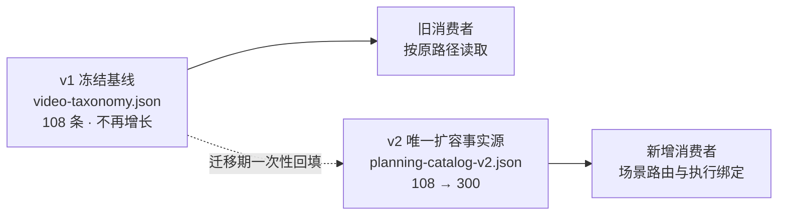

# 设计

## 一、v1 冻结而非退役

现有规格 CAT-02 要求"系统 SHALL 保留 v1 资源路径及原 108 个 ID、例文内容和语义基线"。
因此 `video-taxonomy.json`、`source-index.json`、`scene-index.md` 与
`validate_video_catalog.py` 保持不变，继续校验冻结的 108 条基线。

v1 与 v2 的职责由此收敛为：

由于 v1 不再新增条目，`validate_video_catalog.py` 的 108/18×6/12 硬断言不再构成扩容
阻塞——它校验的是一个不再变化的冻结文件。扩容阻塞实际只存在于 v2 缺少执行绑定与
内容门禁。

## 二、v2 场景执行绑定

v1 的四个执行相关字段在 v2 中补回，命名遵循 v2 既有风格（数组化、带 `_ids` 或
复数后缀）：

| v1 字段 | v2 字段 | 类型 | 作用 |
|---|---|---|---|
| `skills` | `skills` | `string[]` | 场景应调用的技能入口 |
| `required_capabilities` | `required_capabilities` | `string[]` | 场景必须具备的 CLI capability |
| `beats` | `beats` | `string[]` | 叙事节拍，构成执行顺序 |
| `edit` | `editorial_intent` | `string` | 剪辑取舍原则，须逐字出现在例文正文 |

`brief` 已由 v2 的 `applies_when` 承载，`assets` 由 `asset_requirements` 承载，
`acceptance` 与 `guardrail` 已分别对应 `acceptance[]` 与 `guardrails[]`，不重复定义。

回填以 `legacy_ids` 为连接键：v2 场景的 `legacy_ids[0]` 对应 v1 的 `id`。
回填脚本必须幂等——对已有字段的场景不得覆盖，且不改动 v1 文件。

## 三、内容一致性门禁回填

v2 校验器新增两条检查，均以场景已解析出的本地文件为输入：

1. **例文与目录一致**：例文正文必须逐字包含 `editorial_intent`，
   且包含 `acceptance` 数组中的每一条。缺失返回 `scene_example_disagrees`。
2. **来源可达正文**：场景引用的每个来源，其 `url` 必须出现在例文正文中。
   缺失返回 `scene_source_not_cited`。

这两条只对 `status == "published_knowledge"` 的场景生效；`test_fixture` 在
`--allow-test` 下跳过正文检查，避免测试夹具被文档门禁拖累。

实现复用现有 `safe_file` 的路径与体积边界，不新开读取通道。

## 四、骨架生成器边界

生成器只产出**结构正确、内容待填**的例文，职责边界必须写死：

- 可生成：七段骨架、能力映射行、Harness 交接输入、验收失败分支的固定条目、
  护栏声明模板、来源引用行。
- 不可生成：`name`、`editorial_intent`、`beats`、`asset_requirements`、
  `acceptance`、`guardrails` 的具体语义，以及来源的 `url` / `title` / `query` /
  `accessed_on` / 热度陈述。

生成器 MUST NOT 自行编造来源 URL 或热度数值。缺少来源记录时输出占位并以非零码退出，
把"来源必须人工核实"变成结构性约束而非文档约定。

生成器输出必须能直接通过 v2 校验器的两条新门禁——这是它可用性的判据。

## 五、"108" 字面量的处理

扩容到 300 由后续变更负责，本次只把"108 是硬上限"这一**错误暗示**从正文中移除，
改为引用目录实际规模。正文保留当前真实数字作为基线陈述，但必须标明"以目录为准"，
避免下一轮再次出现"改数字要改七个文件"的维护债。
